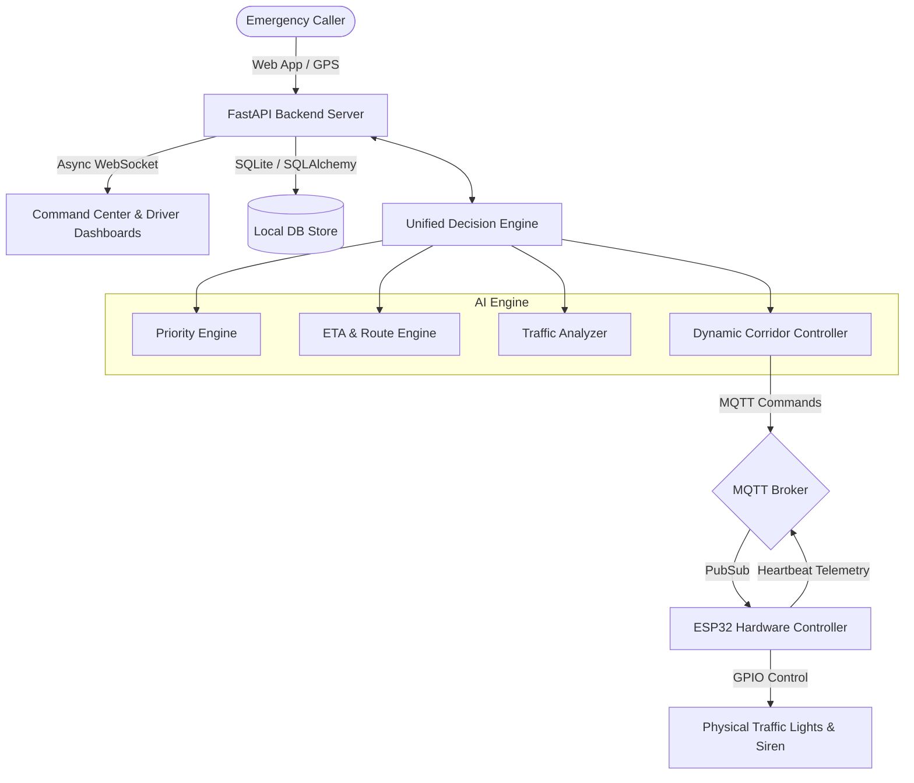
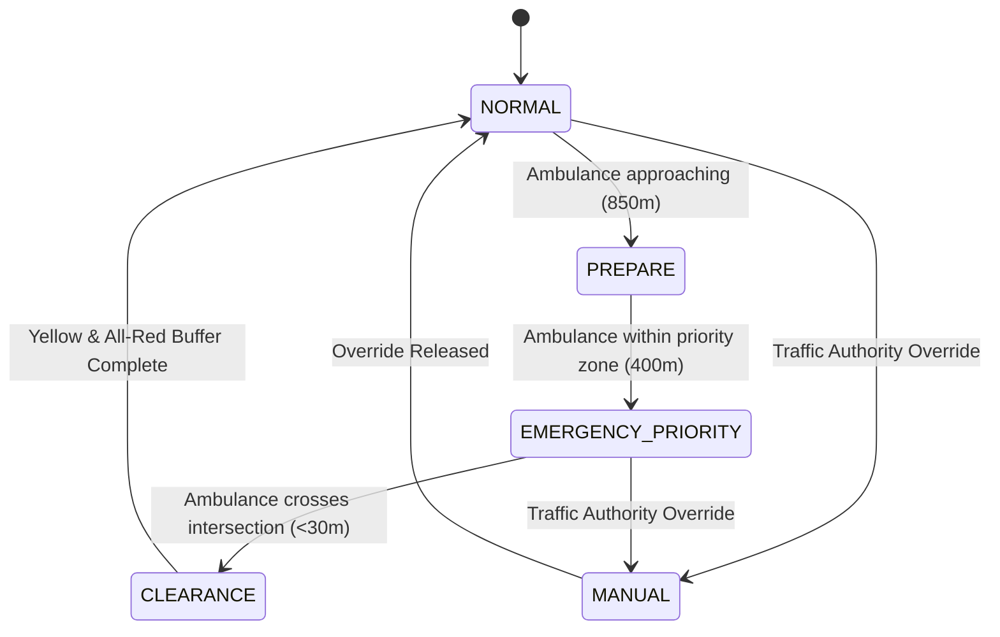

# 🏛️ Aegis Flow — System Architecture & Technical Specifications

> **⚠️ Hackathon Disclaimer:** Aegis Flow is an academic innovation prototype designed for emergency response coordination. It is not connected to real emergency or municipal traffic infrastructure.

---

## 1. System Overview

Aegis Flow connects emergency callers, dispatchers, drivers, hospitals, and traffic control infrastructure into a synchronized, AI-governed green corridor network.

---

## 2. Core Subsystems

### 2.1 Backend & Communication Layer
- **Framework:** FastAPI (Python 3.12)
- **API Paradigm:** RESTful endpoints for CRUD + WebSockets for sub-100ms bidirectional telemetry.
- **Message Broker:** Eclipse Mosquitto / Python `paho-mqtt` v2.x with auto-fallback to software simulation.
- **Security:** JWT (HMAC-SHA256) with role-based access control (`patient`, `driver`, `hospital`, `traffic`, `admin`). Password hashing with multi-round `bcrypt`.

### 2.2 AI Decision Engine
The AI layer provides deterministic, explainable recommendations:
1. **Dynamic Priority Score (0–100):**
   $$\text{Score} = \text{Severity} (40) + \text{Condition} (25) + \text{Congestion} (15) + \text{Delay} (12) + \text{Distance} (8)$$
2. **Dynamic Green Wave ETA Engine:**
   Calculates travel time reduction by factoring in preemption of red signal intervals (reducing average intersection wait from ~45s to ~4s).
3. **Queue Clearance Time Analyzer:**
   Evaluates approach queue volume and computes the advance window needed for cross-traffic queue dissipation before the ambulance arrives.
4. **Corridor Preemption Controller:**
   Monitors vehicle trajectory, identifies signals within 850m (Prepare) and 400m (Emergency Priority), and triggers clearance upon intersection passage.

### 2.3 Traffic Signal State Machine
The state machine strictly enforces transit safety:

#### Safety Invariants:
- **Green Conflict Lock:** North-South and East-West directions can NEVER both be Green simultaneously.
- **Mandatory Yellow Clearance:** Minimum 3.0s Yellow and 2.0s All-Red interval before switching directions.
- **Watchdog Fail-Safe:** Any emergency priority command automatically expires after 45–60 seconds if no heartbeat or refresh is received, safely returning to autonomous cyclic scheduling.

---

## 3. IoT & Hardware Layer
- **Microcontroller:** ESP32 DevKit V1 (Tensilica Dual-Core 240MHz).
- **Network:** 802.11 b/g/n 2.4GHz WiFi.
- **Telemetry Protocol:** MQTT over TCP (Port 1883).
- **Physical Output:** 6 current-limited LEDs (Red, Yellow, Green for 2 approaches) + 5V Piezo Alert Buzzer.
- **Autonomous Local Mode:** Runs an independent internal timing loop (`millis()`), ensuring full local signal cycling even if internet or broker connectivity drops.
